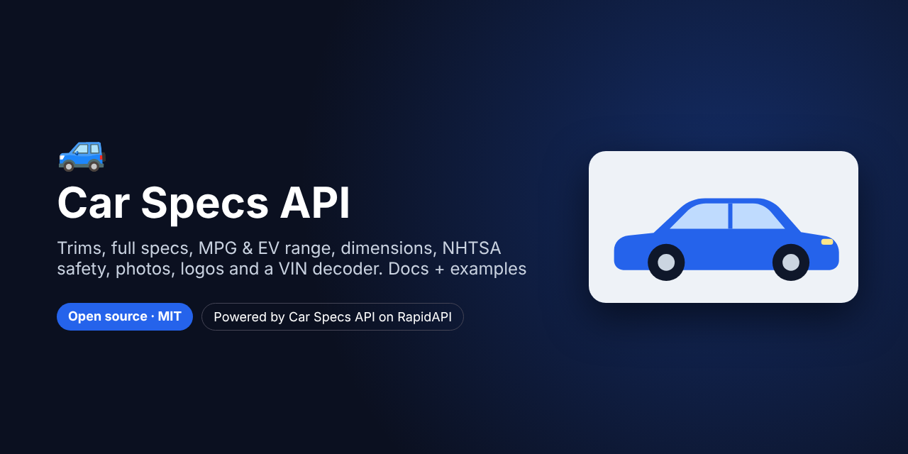

# Car Specs API – Trims, Specs, MPG, Dimensions, Safety, Photos & VIN Decoder



[](https://rapidapi.com/belchiorarkad-FqvHs2EDOtP/api/car-specs-api)
[](https://t.me/pintoflow)


> **For faster support reply, contact us on Telegram: [@pintoflow](https://t.me/pintoflow)**

**Get the API: https://rapidapi.com/belchiorarkad-FqvHs2EDOtP/api/car-specs-api**

Everything you need to build a **car catalog, comparison tool, VIN decoder or listing page**:

- **Catalog:** years, makes, models and vehicle types, plus free-text search ("2021 toyota rav4")
- **Trims and full specs:** engine, transmission, drivetrain, powertrain (gas, hybrid, plug-in hybrid, electric), vehicle class, interior and cargo volume
- **Fuel economy:** MPG and L/100 km, MPGe, EV range and charge time, CO₂, annual fuel cost and EPA scores
- **Dimensions:** length, width, height, wheelbase, track, curb weight and weight distribution (metric and imperial)
- **Images:** licensed vehicle photos with ready-made attribution, brand logos and NHTSA crash-test photos
- **Safety:** NHTSA 5-star ratings
- **VIN decoder:** decode a VIN, or go straight from a VIN to its matching trims, specs, dimensions and photos; batch up to 50 VINs
- **Compare:** up to 4 trims side by side, with the best value in each row highlighted

This repository contains the documentation plus ready-to-run examples in **cURL**, **Node.js** and **Python**.

---

## Quick start

```bash
curl --request GET \
  --url 'https://car-specs-api.p.rapidapi.com/vehicle?make=toyota&model=rav4&year=2021' \
  --header 'x-rapidapi-host: car-specs-api.p.rapidapi.com' \
  --header 'x-rapidapi-key: YOUR_RAPIDAPI_KEY'
```

```json
{
  "success": true,
  "data": {
    "summary": "2021 Toyota RAV4: 8 EPA trims · powertrains Gasoline · 28–30 MPG combined · NHTSA overall rating 5/5 · length 459 cm",
    "vehicle": { "year": 2021, "make": "Toyota", "model": "RAV4" },
    "trims": [ … ], "specs": [ … ], "dimensions": [ … ], "images": [ … ], "safetyRatings": [ … ]
  },
  "meta": { "requestId": "…", "tookMs": 2041 }
}
```

### Typical flow

1. `GET /makes?year=2024`: pick a make
2. `GET /models?make=honda&year=2024`: pick a model
3. `GET /trims?make=honda&model=civic&year=2024`: pick a trim and get its `id`
4. `GET /specs/47069`: the full spec sheet for that trim

Or call `GET /vehicle?make=honda&model=civic&year=2024` for everything at once, or `GET /vin/specs?vin=…` when you have a VIN.

---

## Examples in this repo

| File | What it does |
|---|---|
| [`examples/curl/examples.sh`](examples/curl/examples.sh) | One cURL call for each main endpoint |
| [`examples/node/vin-to-specs.mjs`](examples/node/vin-to-specs.mjs) | Decode a VIN and print its matching trims, MPG, dimensions and safety rating |
| [`examples/node/compare.mjs`](examples/node/compare.mjs) | Compare two models (first trim of each) side by side in the terminal |
| [`examples/python/bulk_vin_to_csv.py`](examples/python/bulk_vin_to_csv.py) | Decode a file of VINs in batches of 50 and save a CSV |
| [`examples/python/ev_range_table.py`](examples/python/ev_range_table.py) | Table of EV range, MPGe and charge time for a list of models |

```bash
export RAPIDAPI_KEY=your_key_here
node examples/node/vin-to-specs.mjs 1HGCM82633A004352
node examples/node/compare.mjs "toyota rav4 2021" "honda cr-v 2021"
python3 examples/python/bulk_vin_to_csv.py vins.txt
```

---

## Response format

```json
{ "success": true,  "data": { … }, "meta": { "requestId": "…", "tookMs": 120 } }
{ "success": false, "error": { "code": "NO_SPEC_DATA", "message": "…", "details": { … } }, "meta": { "requestId": "…" } }
```

`meta` can also contain `pagination` (`page`, `perPage`, `total`, `totalPages`, `hasNextPage`), `warnings` and `sectionErrors`. Make and model names are case-insensitive, and spaces and dashes are ignored (`cr-v`, `CRV` and `Cr V` all work).

## Endpoints

### Catalog
| Endpoint | Description |
|---|---|
| `GET /years` | Model years with spec data (1984 to next year) |
| `GET /makes` | Makes. Optional: `year` (only makes with specs that year), `type`, `search`, `page`, `perPage` |
| `GET /makes/{make}` | Make profile: logo, vehicle types, manufacturers |
| `GET /models?make=` | Models. Optional: `year`, `type`, `search`, `source` (`vpic` official names or `epa` trim names), `page`, `perPage` |
| `GET /vehicle-types` | Vehicle type names usable in `type=` |
| `GET /search?q=` | Free text such as `2021 toyota rav4` or `bmw x5 2020` |

### Trims & specs
| Endpoint | Description |
|---|---|
| `GET /trims?make=&model=&year=` | Every engine/transmission variant, each with an `id` |
| `GET /specs/{id}` | Full spec sheet for one trim |
| `GET /specs?make=&model=&year=` | Full spec sheets for every trim (paginated) |
| `GET /mpg?make=&model=&year=` or `?id=` | Fuel economy only |
| `GET /dimensions?make=&model=&year=` | Dimensions per body variant |
| `GET /compare?ids=41189,47069` | 2–4 trims side by side, each comparable row with a `bestId` |
| `GET /vehicle?make=&model=&year=` | Everything in one call |

A spec sheet includes `powertrain`, `drivetrain`, `engine`, `electricMotor`, `transmission`, `fuel`, `interior`, `fuelEconomy` (MPG, L/100 km, and for EVs `electric.kWhPer100Miles`, `rangeMiles`, `chargeTimeHours240V`), `emissions` (CO₂, EPA scores), `costs` (annual fuel cost, 5-year savings) and a one-line `summary`.

### Images & safety
| Endpoint | Description |
|---|---|
| `GET /images?make=&model=&year=` | Photos with `url`, `thumbnailUrl`, `license`, `author`, `attribution`, `matchesYear` (`limit` ≤ 20, `width` 120–2560) |
| `GET /logo?make=` (or `/makes/{make}/logo`) | Brand logo (`url`, `pngUrl`) |
| `GET /safety-ratings?make=&model=&year=` (or `?vin=`) | NHTSA overall, frontal, side, pole and rollover stars, safety tech, crash-test photos |

### VIN
| Endpoint | Description |
|---|---|
| `GET /vin/decode?vin=` | Make, model, year, trim, body, engine (incl. horsepower), transmission, plant, weight class |
| `GET /vin/specs?vin=` | VIN → full bundle (like `/vehicle`) + `likelyTrimIds` and `engineMatch` |
| `GET /vin/validate?vin=` | Length, illegal characters and check digit, with a `suggestion` |
| `GET /vin/decode-basic?vin=` | Offline decode: region, country, manufacturer, model-year candidates (any country) |
| `POST /vin/batch` | `{"vins": [...]}`, up to 50 VINs |
| `GET /vin/wmi?code=1HG` | Manufacturer behind a VIN's first 3 characters |

## Errors

| HTTP | `error.code` | What to do |
|---|---|---|
| 400 | `MISSING_*`, `INVALID_*` | Fix the parameter. The message shows an example. |
| 404 | `NO_SPEC_DATA`, `TRIM_NOT_FOUND`, `MAKE_NOT_FOUND`… | Nothing found. Check names with `/models?source=epa`. |
| 413 | `TOO_MANY_VINS` | Send at most 50 VINs |
| 422 | `VEHICLE_NOT_IDENTIFIED` | The VIN decoded but not to a make/model/year (common for non-US vehicles) |
| 502 / 504 | `UPSTREAM_UNAVAILABLE` / `UPSTREAM_TIMEOUT` | Retry with backoff (2 s, 5 s, 15 s) |

**Retry only 502 and 504.** Cache specs for past model years: they never change.

## Coverage

Trims, specs, MPG and EV range cover **cars, SUVs, vans and light trucks sold in the USA, model year 1984 to next year**. VIN decoding covers every vehicle type registered with NHTSA. Safety ratings cover vehicles crash-tested by NHTSA. Photos are community photos with licence information.

---

## Built with this API

- 🔎 [Free VIN Decoder](https://github.com/BelNaruto/free-vin-decoder): full specs, MPG, safety and photos from a VIN, plus bulk decoding to CSV
- 🚗 [Car Comparison Tool](https://github.com/BelNaruto/car-comparison-tool): compare up to 4 cars side by side
- ⛽ [Car Fuel Cost Calculator](https://github.com/BelNaruto/car-fuel-cost-calculator): gas vs hybrid vs plug-in vs electric running costs

## Support

> **For faster support reply, contact us on Telegram: [@pintoflow](https://t.me/pintoflow)**

- RapidAPI listing: https://rapidapi.com/belchiorarkad-FqvHs2EDOtP/api/car-specs-api

---

*Data from NHTSA vPIC, US EPA / DOE fueleconomy.gov, NHTSA NCAP and Wikimedia Commons. Not affiliated with any vehicle manufacturer. Brand names and logos are trademarks of their owners.*

**Keywords:** car specs api, vehicle specs api, vin decoder api, car data api, mpg api, ev range api, car dimensions api, nhtsa safety ratings api, car images api, car comparison api, rapidapi
